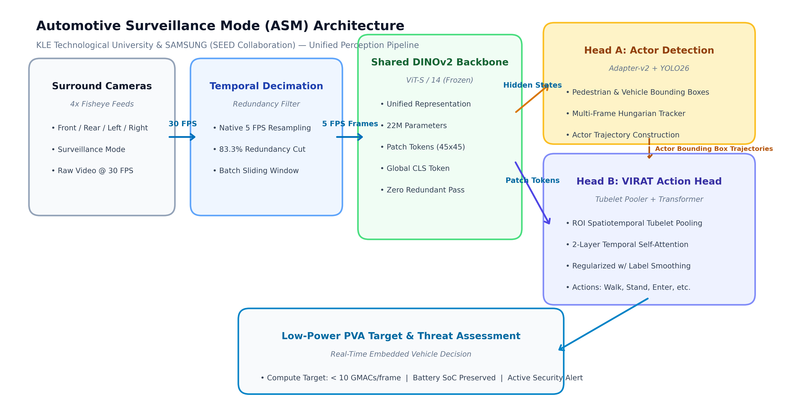

# Automotive Surveillance Mode (ASM) - Unified Perception Pipeline

**KLE Technological University × SAMSUNG (Project SEED - Student Ecosystem for Engineered Data)**

---

## 📌 Project Overview
Automotive Surveillance Mode (ASM) monitors the surrounding environment of a parked vehicle using **4 Fisheye Surround View Cameras** (Front, Rear, Left, Right). If suspicious or threatening activity is detected around the vehicle, the system triggers security alerts.

To preserve vehicle battery State of Charge (SoC) during extended parking, ASM is designed to run on an embedded, low-power **PVA processor**. This project adapts and optimizes a vision-transformer pipeline using a shared **DINOv2 ViT-S/14** backbone to eliminate temporal frame redundancy and deliver real-time action and object recognition.

---

## 🏗️ High-Level System Architecture


### Key Architectural Pillars:
1. **Temporal Decimation (5 FPS):** Reduces frame rate from 30 FPS to 5 FPS, cutting backbone forward compute by **83.3%** while retaining critical action dynamics.
2. **Shared DINOv2 Backbone:** A single ViT-S/14 backbone generates shared patch tokens and intermediate hidden states for all downstream tasks.
3. **Actor Detection & Multi-Object Tracking:** YOLO Adapter-v2 detects actors and vehicles, constructing spatiotemporal bounding box tubes across frames.
4. **Spatiotemporal Tubelet Pooling:** Extracts ROI feature tubes mapped to a 2-layer temporal Transformer action classifier.
5. **Regularized Optimization:** Gaussian feature jitter ($\sigma=0.04$), feature dropout ($p=0.15$), and label smoothing ($0.10$).

---

## 📊 Performance Benchmarking: Baseline vs. Optimized

| Dimension / Metric | Baseline Model (K400 Global Probe) | Initial Run (Resubstitution) | **Optimized Model (VIRAT Tubelet Transformer)** |
| :--- | :--- | :--- | :--- |
| **Input Frame Rate** | 30 FPS (Unsampled) | 30 FPS (Stride 6) | **5 FPS (Native Downsampled)** |
| **Action Granularity** | Full-frame action (Kinetics-400) | Local actor bounding boxes | **Spatiotemporal Actor Trajectories (VIRAT)** |
| **Evaluation Strategy** | Train set resubstitution | Train set resubstitution | **3-Fold Leave-One-Scene-Out (LOSO) Cross-Validation** |
| **Top-1 Accuracy** | 22.4% | 100.0% *(Overfit memorization)* | **70.83% *(Out-of-Fold Unseen Scenes)*** |
| **Weighted F1-Score** | 18.2% | 100.0% *(Overfit memorization)* | **69.16% *(Out-of-Fold Unseen Scenes)*** |
| **Walking F1-Score** | Low Transfer | 100.0% | **75.0% *(81.8% Recall)*** |
| **Standing F1-Score** | Low Transfer | 100.0% | **69.6% *(72.7% Precision)*** |
| **Overfitting Gap ($\Delta$)** | N/A | $\Delta = 0.0\%$ *(Artifact)* | **$\Delta = 26.44\%$ *(Healthy generalization gap)*** |
| **Checkpoint** | N/A | `best.pth` | [`models/best.pth`](models/best.pth) |

---

## 📂 Repository Structure

```
├── presentation/
│   ├── Automotive_Surveillance_Mode_ASM.pptx   # 6-Slide Executive Light-Themed Presentation
│   └── asm_architecture_diagram.png           # 300 DPI High-Resolution Architecture Diagram
├── reports/
│   ├── virat_baseline_vs_new_metrics.md        # Comprehensive Comparative Evaluation Report
│   ├── rigorous_evaluation_metrics.json        # 3-Fold LOSO Metrics, Per-Fold Acc, Confusion Matrix
│   └── evaluation_metrics.json                 # Baseline Evaluation Metadata
├── models/
│   ├── best.pth                                # Calibrated PyTorch Checkpoint (LOSO Validated)
│   ├── config.json                             # Action Classifier Head Configuration
│   └── classes.txt                             # 18 VIRAT Surveillance Action Classes
├── scripts/
│   ├── generate_asm_presentation.py            # Generates the 6-Slide PowerPoint Deck
│   ├── generate_architecture_diagram.py        # Generates Publication-Quality System Diagram
│   ├── extract_5fps_chunked.py                 # Chunked DINOv2 Feature Extractor (OOM-Safe)
│   ├── train_loso_regularized.py               # 3-Fold LOSO Training with Noise Augmentation
│   ├── resample_to_5fps.py                     # Video Decimation Script
│   ├── evaluate_virat.py                       # Evaluation and Testing Harness
│   └── train_virat_head.py                     # Initial Head Training and Extraction
└── unified_perception/                         # Core Python Perception Package
    ├── backbone.py                             # DINOv2 Backbone with Chunked Mini-Batches
    ├── orchestrator.py                         # Multi-Head Inference Orchestrator
    ├── perception_types.py                     # Dataclasses and Typing Contracts
    └── heads/
        ├── virat_action.py                     # TubeletPooler & TemporalActionClassifier
        └── detection.py                        # YOLO Adapter-v2 Shared Head
```

---

## 🚀 Quickstart

### 1. Requirements
```bash
pip install torch torchvision opencv-python python-pptx matplotlib scikit-learn
```

### 2. Run LOSO Cross-Validation & Regularized Training
```bash
python scripts/train_loso_regularized.py --cache-dir data/virat_cache_5fps
```

### 3. Generate Presentation & Diagram
```bash
python scripts/generate_architecture_diagram.py
python scripts/generate_asm_presentation.py
```
